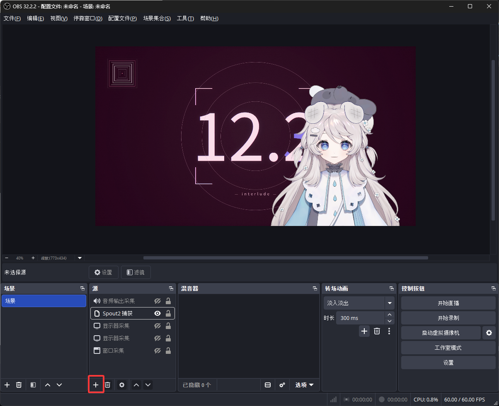
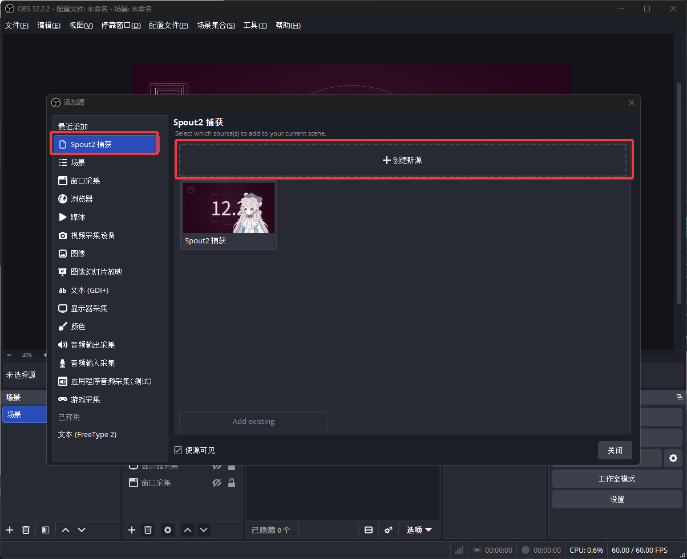
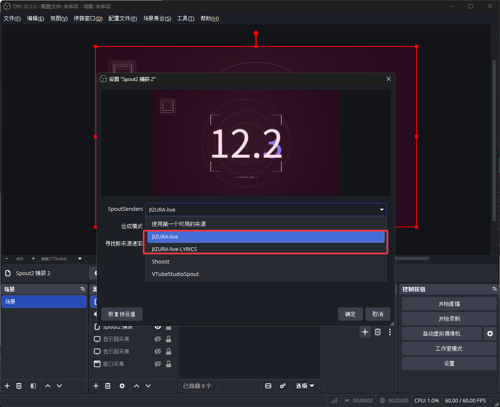
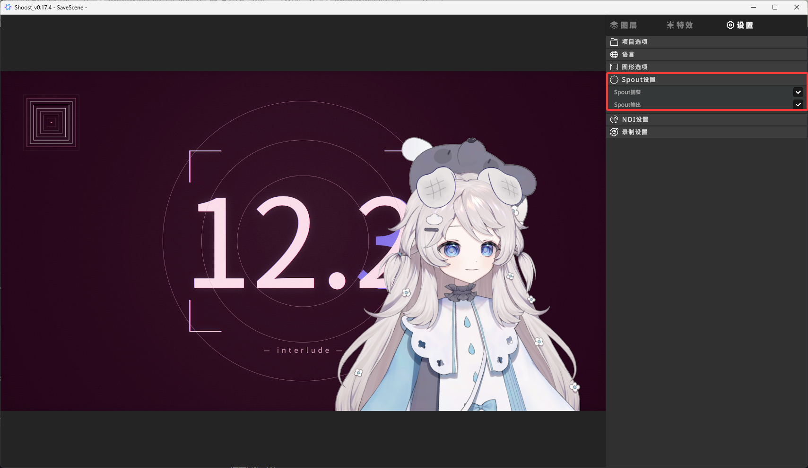
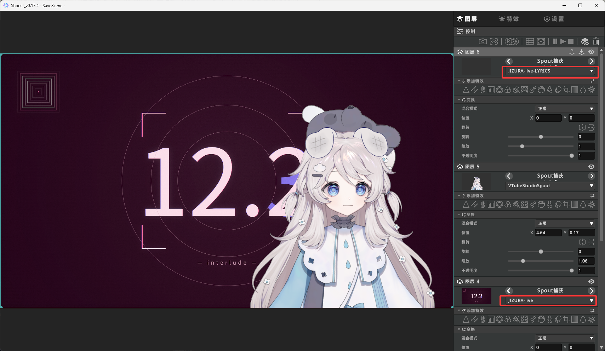

Spout 是一种进程间的共享纹理传输方式。字面 Live 把渲染结果直接作为纹理交给接收端，
不落地、不截屏、不走窗口捕获 —— 所以延迟低、画质不损失。

## 两条通道

开启后字面 Live 会注册两个 Spout 发送端：

| 通道 | 名称 | 内容 |
|---|---|---|
| 主通道 | `{Spout ID}` | 完整画面，`渲染窗口分辨率` @ `渲染帧率` |
| 字幕通道 | `{Spout ID}-LYRICS` | 恒透明底，只出字幕层，帧率取 `min(字幕渲染帧率, 渲染帧率)` |

`Spout ID` 默认是 `JIZURA-live`，可以在设置里改。

分开两个通道的用处：**在 OBS 里把字幕单独叠一层**。改字幕样式、调位置、换行，
都不需要重开一次渲染；主画面那层不受影响。

字幕通道没有 KRC 字幕数据时输出全透明帧 —— 也就是接上了但什么都不显示，不会报错。

## 透明底

勾「渲染透明背景」后，主通道输出的是带 alpha 的图层，可以直接叠在别的素材上，
不用抠像。

## 绿幕 / 黑幕与合成

除了透明底，也可以把「设置」页的**背景**切成 **绿幕** 或 **黑幕**：此时只在单色底上
绘制白色文字与演出，在 OBS 里合成。背景与「导出」页同源。

- **绿幕** —— 给 Spout 来源加一个「色度键」滤镜，抠掉绿色。
- **黑幕** —— 把 Spout 来源图层的混合模式设为**「滤色」**（Screen）：黑色变透明，
  你自己的画面与背景就露出来了。不需要这个效果时，就别开黑幕去滤色。

> 字幕通道本身是恒透明底，不需要抠像，直接叠在主画面上方即可。

## 帧率与暂停

- 播放时按目标帧率出图。
- **暂停时降到 10Hz**，而且只在画面真的会变（seek、重规划、换字幕）时才重绘 ——
  不空转烧 CPU / GPU。
- 暂停期间会持续重发上一帧纹理（保活）。OBS 这类接收端在发送端静默一段时间后会
  判定掉线，保活就是防这个。

## GPU 与 CPU 两条路

- **GPU（默认）**：ANGLE 在 D3D11 上跑 GL，Skia 直接画进那块要发给 Spout 的共享纹理 ——
  全程 GPU，没有一个像素经过 CPU 内存。1080p 实测约 7ms 一帧。
- **CPU（回退）**：缺 ANGLE 二进制、初始化失败，或设了 `JIZURA_GPU=0` 时自动回退。
  1080p 约 46–64ms 一帧。

两条路对接收端没有区别，通道名和帧率语义完全一样。

## 设置项

在「设置」页的 **Spout 输出** 分组里：

| 项 | 说明 |
|---|---|
| Spout 输出 | 总开关 |
| Spout ID | 发送端名字，字幕通道自动加 `-LYRICS` 后缀 |
| 渲染透明背景 | 主通道输出透明图层 |
| 独立 Spout 字幕通道 | 开启第二个通道 |
| 字幕渲染帧率 | 字幕通道帧率，生效值不超过渲染帧率 |

这些改动要点「重启渲染引擎」按钮才生效（和渲染窗口分辨率、渲染帧率一样）。
设置项各自什么时候生效，见[性能与高级设置](../advanced/)。

## 接收端

接收端需要支持 Spout。分层叠的时候，加两个来源 / 图层，分别选 `{Spout ID}` 和
`{Spout ID}-LYRICS`，**字幕那层放在主画面上方**。

下面以 OBS 与 Shoost 为例。

## OBS 快速入门

OBS 本身不带 Spout 支持，需要先装插件。

1. **装插件** —— 到 [obs-spout2-plugin](https://github.com/Off-World-Live/obs-spout2-plugin)
   下载并安装（装之前先退出 OBS）。
2. **加来源** —— 在「来源」面板点底部的「+」，选 **Spout2 捕获**。

   

   

3. **选通道** —— 弹出的属性窗口里，把 `SpoutSenders` 选成 `JIZURA-live`。

   

4. **字幕单独一层** —— 再加一个「Spout2 捕获」，这次选 `JIZURA-live-LYRICS`，
   把它拖到主画面上方。
5. **看效果** —— 回字面 Live 点播放，OBS 里就能看到实时画面。

## Shoost 快速配置

Shoost 自带 Spout 支持，不用装插件。

1. **开捕获** —— 在 Shoost「设置 → Spout 设置」里打开 **Spout 捕获**。

   

2. **加两个图层** —— 添加两个「Spout 捕获」图层：
   - **渲染图层** 选 `JIZURA-live`（完整画面）
   - **歌词图层** 选 `JIZURA-live-LYRICS`（纯字幕，透明底）
3. **排顺序** —— **歌词图层要放在渲染图层上面**，否则字幕会被主画面盖住。

   

4. **看效果** —— 回到字面 Live 点播放，Shoost 画面里就能看到实时效果。

图层里能选到的名字就是字面 Live「设置 → Spout ID」里的值（默认 `JIZURA-live`，
字幕通道自动加 `-LYRICS`）。改过 Spout ID 之后，Shoost 这边要重新选一次。

## 想让文字避开角色

直播时角色通常占画面中央。用「设置」页的 **自定义留出画面范围** 把中间空出来，
文字与演出会自动排到两侧或上下，竖屏也一样。留空范围在预览里用虚线标出，
方便对齐角色位置。
